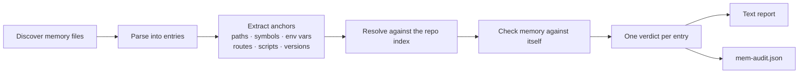

<div align="center">

# Mem-Audit by DocuSOR

**Find out what your coding agent remembers wrong.**

Mem-Audit checks the memory files AI coding agents keep about your repository against the real code, and against themselves.<br/>
It flags stale, contradictory and superseded notes, and shows what never needed to be agent memory in the first place.

[](LICENSE)
[](package.json)
[](package.json)
[](#privacy-and-determinism)
[](#privacy-and-determinism)

[Quick start](#quick-start) ·
[What it checks](#what-it-checks) ·
[Supported agents](#supported-agents) ·
[CLI reference](#cli-reference) ·
[CI & hooks](#use-it-in-ci-and-agent-hooks) ·
[FAQ](#faq)

</div>

---

## Why

Coding agents (Copilot, Claude Code, Cursor and others) keep notes about your repo so they don't have to rediscover it every session. Those notes go wrong quietly:

- **They go stale.** A file gets renamed, a function deleted, a default changed, and the note still says the old thing.
- **They contradict each other.** One entry says the cache runs on port `6379` and a later one says `6380`. The agent has no idea which one to trust.
- **They hold things that were never the agent's job.** Ports, routes, env defaults and file layouts are already in the repo. Copying them into private memory just creates another thing that drifts.

Mem-Audit reads that memory, resolves every file, symbol, script, env var and version it mentions against the actual repository, and tells you exactly which lines are wrong, which are outdated, and which don't belong in agent memory at all.

## Quick start

```sh
# audit the repository in the current directory
npx mem-audit

# memory that talks about sibling repos? index them too
npx mem-audit . --related ../api ../shared-lib

# fail a CI job when memory is wrong
npx mem-audit --fail-on stale,contradiction,redact
```

Every run prints a report and writes the full audit to **`mem-audit.json`** (see [JSON output](#json-output)).

## Example

Given a repo where `API_PORT` defaults to `8080`, the package is at `2.4.0`, and `legacyAuth()` has been deleted:

```text
$ mem-audit --file notes/memory.md

== Memory vs the repo ==

CONTRADICTION (2) — memory disagrees with the code
  file:notes/memory.md:5
    - `API_PORT` default is `3000` here, but the code says `8080` (app)
  file:notes/memory.md:6
    - acme-api is 2.1.0 here, but its package.json says 2.4.0 (app)

STALE (3) — points at files, scripts or symbols that no longer exist
  file:notes/memory.md:7
    - `src/routes/legacy.ts` no longer exists in app
  file:notes/memory.md:8
    - npm script `seed` isn't in any package.json
  file:notes/memory.md:12
    - `legacyAuth` isn't in the code anymore
    - `legacyAuth` was removed per file:notes/memory.md:9 (2026-03-02)

== Memory vs itself ==

SUPERSEDED (1) — replaced by a newer entry or a later removal
  file:notes/memory.md:15
    - redis service port is `6379` here; newer file:notes/memory.md:18 (2026-04-01) says `6380`

== Doesn't need to be agent memory ==

REPO-FACT (1) — the repo already says this; read it there, or keep it in shared, verified context
HISTORY (1) — changelog notes; git history already has them

== Belongs in agent memory ==

KEEP-LOCAL (1) — personal or machine-specific

Summary: 10 entries, 6 wrong or outdated (60%).
JSON audit: mem-audit.json
```

## What it checks

### Memory vs the repo

| Check | Example |
|---|---|
| Files and directories that no longer exist | `src/routes/legacy.ts` was deleted |
| Functions, classes and identifiers missing from the code | `legacyAuth()` is gone |
| npm scripts that aren't in any `package.json` | `npm run seed` |
| Env var defaults that differ from the code or `.env.example` | memory says `3000`, code says `8080` (unit-aware: `300s` = `300000` ms) |
| Package versions that differ from `package.json` | memory says `2.1.0`, package is `2.4.0` |
| Credentials pasted into memory | Stripe, GitHub, AWS and Slack tokens, JWTs, private keys, passwords in URLs |

### Memory vs itself

| Check | How it decides |
|---|---|
| **Value conflicts**: the same env var, service port, version or check count with different values | The repo decides first; otherwise the entry with the newer explicit date wins |
| **Removed vs still described**: one entry says `X` was removed while another still describes `X` | The repo confirms the removal; otherwise dates decide |
| **Superseded sections**: everything under a heading that has been superseded | Inherited, unless the child entry still checks out against the repo |
| **Duplicates**: the same note recorded twice, within or across files | Normalized text match or ≥ 90% token overlap |

Detection is driven by **anchors and values** (paths, symbols, env vars, ports, versions), not by any particular wording. Phrases like *"replaced by"*, *"no longer"*, *"deprecated"* or *"renamed to"* only scope which sentence a removal applies to. If neither the repo nor a date can settle a disagreement, both entries are flagged rather than guessing.

### Verdicts

Every memory entry gets exactly one verdict:

| Verdict | Meaning | What to do |
|---|---|---|
| `redact` | Contains a credential-shaped value (always masked in output) | Remove it |
| `contradiction` | Disagrees with the code | Fix or delete |
| `stale` | Points at something that no longer exists | Delete |
| `superseded` | Replaced by a newer entry or a later removal | Delete |
| `conflict` | Disagrees with another entry; nothing settles which is right | Resolve by hand |
| `repo-fact` | The repo already says this | Doesn't need to be agent memory |
| `history` | A changelog line | Git history already has it |
| `duplicate` | Repeated elsewhere in memory | Keep one |
| `keep-local` | Personal or machine-specific (home paths, preferences, OS setup) | This is what memory is for |
| `review` | No repo anchors or local signals | Review by hand |

## How it works



1. **Discover**: finds each agent's memory for the repository (see [Supported agents](#supported-agents)).
2. **Parse**: splits markdown into entries: list items, paragraphs, table rows, code blocks and headings, each with its file, line and section.
3. **Index**: reads the repo with `git ls-files` (tracked and untracked, honoring `.gitignore`), or a directory walk outside git. Docs and migration history are excluded when asking *"is this still in the code?"*, so a stale mention in an old README can't keep a deleted symbol alive.
4. **Resolve and compare**: each anchor resolves to `resolved`, `missing`, `external` or `unknown`. A path is only called stale when its top-level directory exists, so another project's paths are reported as external, not wrong.
5. **Report**: a grouped text report on stdout and the full result as JSON.

## Supported agents

| Source | Files read |
|---|---|
| **GitHub Copilot (VS Code)** | Repo memory for the matching workspace (`workspaceStorage/<id>/…/memories/repo/`) and user memory (`globalStorage/…/memories/`). Supports Code, Code – Insiders and VSCodium on macOS, Linux and Windows. |
| **Claude Code** | `CLAUDE.md` (any depth), `CLAUDE.local.md`, `~/.claude/CLAUDE.md`, and project auto-memory (`~/.claude/projects/<repo>/memory/`) |
| **Committed instruction files** | `AGENTS.md`, `GEMINI.md`, `.github/copilot-instructions.md`, `.github/instructions/*.instructions.md`, `.cursor/rules/*`, `.cursorrules` |
| **Anything else** | Any markdown file passed with `--file` |

Use `--list` to see exactly which files will be audited.

## CLI reference

```text
mem-audit [root] [options]
```

| Option | Description |
|---|---|
| `root` | Repository to audit (default: current directory) |
| `--agent <list>` | Memory sources: `copilot`, `claude`, `committed` (default: all) |
| `--file <path>` | Also audit this markdown file (repeatable) |
| `--related <dir...>` | Also index sibling repos that memory refers to |
| `--exclude <text>` | Skip memory files whose path or label contains `<text>` (repeatable) |
| `--no-repo` | Skip repo checks; only check memory against itself |
| `--json` | Print the JSON audit instead of the text report |
| `--out <path>` | Where the JSON audit is written (default: `./mem-audit.json`) |
| `--no-out` | Don't write the JSON audit file |
| `--verbose` | List every entry, not just problems |
| `--fail-on <list>` | Exit `1` when any entry has one of these verdicts |
| `--list` | Only list the memory files that would be audited |
| `--no-hint` | Omit the closing DocuSOR tip |
| `--vscode-user-dir <dir>` | VS Code user data dir to search (repeatable) |
| `--claude-home <dir>` | Claude Code home (default: `~/.claude`) |
| `-h, --help [option]` | Show help; with an option, describe that option in full |
| `-v, --version` | Show the version |

```sh
mem-audit --help --related     # full description and example for any option
```

### Exit codes

| Code | Meaning |
|---|---|
| `0` | Audit completed |
| `1` | An entry matched a `--fail-on` verdict |
| `2` | Usage error |

## JSON output

Every run writes the complete audit to `mem-audit.json` (or `--out <path>`); `--json` prints the same document to stdout.

```jsonc
{
  "tool": "mem-audit",
  "version": "0.1.0",
  "root": "/path/to/repo",
  "repos": ["app", "shared-lib"],
  "files": [{ "label": "copilot:repo/notes.md", "path": "/path/to/notes.md", "source": "copilot", "scope": "repo", "entries": 42 }],
  "summary": {
    "total": 42,
    "counts": { "repo-fact": 25, "stale": 4, "contradiction": 2, "keep-local": 6, "review": 5 },
    "problems": 6,
    "private_total": 42,
    "not_agent_memory": 25
  },
  "entries": [
    {
      "label": "copilot:repo/notes.md",
      "line": 7,
      "kind": "list-item",
      "section": ["Project notes", "API (2026-03-02)"],
      "verdict": "stale",
      "findings": [{ "type": "stale", "message": "`src/routes/legacy.ts` no longer exists in app" }],
      "anchors": [{ "kind": "path", "value": "src/routes/legacy.ts", "status": "missing", "repo": "app" }],
      "text": "- `src/routes/legacy.ts` holds the v1 router"
    }
  ]
}
```

## Use it in CI and agent hooks

**GitHub Actions**: keep committed agent instructions honest:

```yaml
name: mem-audit
on: [pull_request]
jobs:
  audit:
    runs-on: ubuntu-latest
    steps:
      - uses: actions/checkout@v4
      - uses: actions/setup-node@v4
        with:
          node-version: 20
      - run: npx mem-audit --agent committed --no-hint --fail-on redact,stale,contradiction
```

**Claude Code hook**: audit memory whenever a session ends (`.claude/settings.json`):

```json
{
  "hooks": {
    "Stop": [
      { "hooks": [{ "type": "command", "command": "npx mem-audit --no-hint --fail-on redact,stale,contradiction" }] }
    ]
  }
}
```

**Locally**, before trusting an agent's memory on a repo you haven't touched in a while:

```sh
npx mem-audit --fail-on stale,contradiction,superseded,conflict
```

## Privacy and determinism

- **Offline.** No network calls, no telemetry, no LLM. Everything runs on your machine.
- **Never modifies memory.** The only file it writes is the JSON audit.
- **Secrets stay masked** in the terminal report and the JSON output.
- **Deterministic.** Identical inputs produce byte-identical output: stable ordering, no timestamps.
- **Zero dependencies.** Plain Node.js ≥ 18.

## FAQ

<details>
<summary><b>Why would a correct note still be flagged as <code>repo-fact</code>?</b></summary>

Because it's correct *today* and duplicated from the repo. The repo is the source of truth for ports, routes, defaults and layout; a private copy in agent memory is just one more thing that drifts. `repo-fact` isn't an error. It means *this doesn't need to live in agent memory*.
</details>

<details>
<summary><b>My memory mentions other repositories. Will those be marked stale?</b></summary>

No. Paths and names that don't belong to the audited repo are reported as `external`. Pass `--related ../other-repo` to have them checked too.
</details>

<details>
<summary><b>Can it run without a repository?</b></summary>

Yes. `--no-repo` skips the repo index and runs only the memory-vs-memory checks (conflicts, removals, duplicates), with dates as the only tiebreaker.
</details>

<details>
<summary><b>Does it understand my agent's wording?</b></summary>

It doesn't need to. Conflicts are detected from the anchors and values entries share, so they're found regardless of how a model phrases things.
</details>

## Where DocuSOR fits

Mem-Audit tells you what's wrong in agent memory. [DocuSOR](https://docusor.ai) is the alternative to agents keeping that memory themselves: repo facts live as **shared context that is continuously re-verified against the running app**, so every agent on the team reads the same proven facts instead of its own drifting notes.

## Contributing

Issues and pull requests are welcome. Run the test suite with:

```sh
npm test
```

Please keep the tool dependency-free and deterministic. New checks should come with a test fixture.

## License

[Apache-2.0](LICENSE) © DocuSOR
