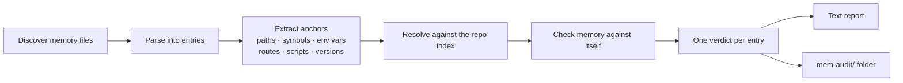

<div align="center">

# Mem-Audit by DocuSOR

**Find out what your coding agent remembers wrong.**

Mem-Audit checks the memory files AI coding agents keep about your repository against the real code, and against themselves.<br/>
It flags stale, contradictory and superseded notes, and shows what never needed to be agent memory in the first place.

[](LICENSE)
[](package.json)
[](package.json)
[](#privacy-and-determinism)
[](#privacy-and-determinism)

[Quick start](#quick-start) ·
[What it checks](#what-it-checks) ·
[Supported agents](#supported-agents) ·
[CLI reference](#cli-reference) ·
[CI & hooks](#use-it-in-ci-and-agent-hooks) ·
[FAQ](#faq)

</div>

---

## Why

Coding agents (Copilot, Claude Code, Cursor and others) keep notes about your repo so they don't have to rediscover it every session. Those notes go wrong quietly:

- **They go stale.** A file gets renamed, a function deleted, a default changed, and the note still says the old thing.
- **They contradict each other.** One entry says the cache runs on port `6379` and a later one says `6380`. The agent has no idea which one to trust.
- **They hold things that were never the agent's job.** Ports, routes, env defaults and file layouts are already in the repo. Copying them into private memory just creates another thing that drifts.

Mem-Audit reads that memory, resolves every file, symbol, script, env var and version it mentions against the actual repository, and tells you exactly which lines are wrong, which are outdated, and which don't belong in agent memory at all.

## Quick start

```sh
# install from npm registry
npm install -g mem-audit

# audit the repository in the current directory
npx mem-audit

# memory that talks about sibling repos? index them too
npx mem-audit . --related ../api ../shared-lib

# fail a CI job when memory is wrong
npx mem-audit --fail-on stale,contradiction,redact
```

Every run prints a report and writes the audit files to a **`mem-audit/`** folder in the repo (see [Output folder](#output-folder)).

## Example

Given a repo where `API_PORT` defaults to `8080`, the package is at `2.4.0`, and `legacyAuth()` has been deleted:

```text
$ mem-audit --file notes/memory.md

== Memory vs the repo ==

CONTRADICTION (2) — memory disagrees with the code
  file:notes/memory.md:5
    - `API_PORT` default is `3000` here, but the code says `8080` (app)
  file:notes/memory.md:6
    - acme-api is 2.1.0 here, but its package.json says 2.4.0 (app)

STALE (3) — points at files, scripts, symbols or values that aren't in this repo
  file:notes/memory.md:7
    - `src/routes/legacy.ts` isn't in app
  file:notes/memory.md:8
    - npm script `seed` isn't in app
  file:notes/memory.md:12
    - `legacyAuth` isn't in app
    - `legacyAuth` was removed per file:notes/memory.md:9 (2026-03-02)

  Tip: DocuSOR re-checks context against the repo on every change, so it doesn't go stale: https://docusor.ai

== Memory vs itself ==

SUPERSEDED (1) — replaced, removed, settled or taken back by a later entry
  file:notes/memory.md:15
    - job timeout is `30s` here; replaced by file:notes/memory.md:18 (2026-04-01), which says `60s` (was `30s`)

  Tip: DocuSOR keeps one verified version of each fact instead of copies that drift apart: https://docusor.ai

== Doesn't need to be agent memory ==

REPO-FACT (1) — names things the repo has, so the repo is the better source; the statement itself isn't verified
HISTORY (1) — records a past event: a removal git history has, a one-time check, or a status line

== Belongs in agent memory ==

KEEP-LOCAL (1) — personal or machine-specific

Summary: 10 entries, 6 wrong or outdated (60%).
2 of 10 private memory entries (20%) don't need to be agent memory.
Audit files: mem-audit/ (summary.json, full mem-audit.json, one file per verdict in agent-todos/ and audit-ready/)
```

## What it checks

### Memory vs the repo

| Check | Example |
|---|---|
| Files and directories that aren't in the repo | `src/routes/legacy.ts` was deleted |
| Functions, classes and identifiers missing from the code | `legacyAuth()` is gone |
| npm scripts that aren't in any `package.json` | `npm run seed` |
| Values the code doesn't set: env defaults, ports, versions, "X is N" notes, bracketed defaults | memory says the retry limit is `3`, the code sets `RETRY_LIMIT = 5` (unit-aware: `60s` = `JOB_TIMEOUT_MS = 60_000`; "grace period (72h default)" = `GRACE_MS = 72 * 3_600_000`). A single "X is N" sentence the code has nothing for is left alone, because the number may be a measurement rather than a setting |
| "Used only" claims about an env var | memory says `API_BASE` is "used only for the login redirect", three code files use it |
| `NAME=value` settings | memory says Docker sets `CHROME_PATH=/usr/bin/chromium`; the reason shows the line that sets it ("checked: … matches Dockerfile:11") |
| Things a note calls gone that the code still has | memory lists `OLD_API_URL` under "removed", `vite.config.ts:32` still reads it. Listed as `still-present`, never counted as a problem |
| Package versions that differ from `package.json` | memory says `2.1.0`, package is `2.4.0` |
| Notes about a repo next to this one | `graph.ts` isn't here but is in `../api`. Env vars, snake_case names and paths that point outside this repo (`../api/src/x.ts`) are looked up there too |
| Credentials pasted into memory | Stripe, GitHub, AWS and Slack tokens, JWTs, private keys, passwords in URLs |

### Memory vs itself

| Check | How it decides |
|---|---|
| **Value conflicts**: the same subject (env var, port, version, "retry limit") with different values | The code decides first: the value it sets is right, and if it sets none of them, all are flagged. If the code has several, a scope ("for new jobs only"), then an explicit "(was X)", then the newer date decides |
| **Scoped replacements**: "for new jobs only, the retry limit is 5" vs a general "3" | The general note is `narrowed`: superseded for that scope, still valid otherwise |
| **Removed vs still described**: one entry says `X` was removed while another still describes `X` | The repo confirms the removal; otherwise dates decide |
| **Superseded sections**: everything under a heading that has been superseded | Inherited, unless the child entry still checks out against the repo |
| **Later corrections**: a note about an open problem or a guess ("blocker", "unproven", "possibly"), then a later heading in the same file that says it was fixed or confirmed, or a later sentence that says it "was wrong" | The earlier note is `superseded` when it shares a specific word with the correction; `ref` points at the correction |
| **Duplicates**: the same note recorded twice, within or across files | Normalized text match or ≥ 90% token overlap |
| **Restated facts**: two entries that look like the same fact in different words | Both record the same name as gone; or a clause in each has the same number and a shared name; or four or more shared specific words covering most of the shorter clause. Listed as `restates`, never counted as a problem |

Detection is driven by **anchors and values** (paths, symbols, env vars, ports, versions, "subject is value" sentences), not by any particular wording. Phrases like *"replaced by"*, *"no longer"*, *"deprecated"* or *"renamed to"* only scope which sentence a removal applies to. Later corrections are the exception: they go by a short, fixed list of words for "open" and "settled". If neither the repo nor a date can settle a disagreement, both entries are flagged rather than guessing.

### Verdicts

Every memory entry gets exactly one verdict, and each verdict with entries gets its own file in the [output folder](#output-folder):

| Verdict | Meaning | What to do | Counts as a problem |
|---|---|---|---|
| `redact` | Contains a credential-shaped value (always masked in output) | Remove it now | Yes |
| `contradiction` | Disagrees with the code | Fix it to match the code, or delete it | Yes |
| `stale` | Points at a file, script, symbol or value that isn't in the repo | Delete or update it | Yes |
| `superseded` | Replaced, removed, settled or taken back by a later entry | Delete it, or update it to match the later entry | Yes |
| `conflict` | Disagrees with another entry; nothing settles which is right | Decide which is right, delete the other | Yes |
| `misplaced` | About a repo next to this one, not this one | Move it to that repo's memory (the finding names it; when several repos share the name, the one that defines it) | No |
| `narrowed` | Replaced only for some cases by a later, scoped entry | Keep it; note the scope it no longer covers | No |
| `duplicate` | Repeated elsewhere in memory | Keep one copy | No |
| `repo-fact` | Names things the repo has, so the repo is the better source. The statement itself isn't verified | Optional: delete and read the repo instead; if kept, don't treat it as verified | No |
| `history` | Records a past event: a removal git history has, a one-time check, or a status line | Optional: delete; don't rely on it for how the repo is now | No |
| `keep-local` | Personal or machine-specific (home paths, preferences, OS setup) | Nothing; this is what memory is for | No |
| `guidance` | A rule or reason about the repo the code can't show ("do NOT…", "…because…") | Nothing; this is what memory is for | No |
| `review` | No repo anchors or local signals | Review by hand | No |

## How it works



1. **Discover**: finds each agent's memory for the repository (see [Supported agents](#supported-agents)).
2. **Parse**: splits markdown into entries: list items, paragraphs, table rows, code blocks and headings, each with its file, line and section.
3. **Index**: reads the repo with `git ls-files` (tracked and untracked, honoring `.gitignore`), or a directory walk outside git. Docs and migration history are excluded when asking *"is this still in the code?"*, so a stale mention in an old README can't keep a deleted symbol alive.
4. **Resolve and compare**: each anchor resolves to `resolved`, `missing`, `elsewhere` (found in a repo next to this one), `external` or `unknown`. A path is only called stale when its top-level directory exists, so another project's paths aren't reported as wrong. Values are looked up where the code sets them.
5. **Report**: a grouped text report on stdout and the [output folder](#output-folder).

## Supported agents

| Source | Files read |
|---|---|
| **GitHub Copilot (VS Code)** | Repo memory for the matching workspace (`workspaceStorage/<id>/…/memories/repo/`) and user memory (`globalStorage/…/memories/`). Supports Code, Code – Insiders and VSCodium on macOS, Linux and Windows. |
| **Claude Code** | `CLAUDE.md` (any depth), `CLAUDE.local.md`, `~/.claude/CLAUDE.md`, and project auto-memory (`~/.claude/projects/<repo>/memory/`) |
| **Committed instruction files** | `AGENTS.md`, `GEMINI.md`, `.github/copilot-instructions.md`, `.github/instructions/*.instructions.md`, `.cursor/rules/*`, `.cursorrules` |
| **Anything else** | Any markdown file passed with `--file` |

Use `--list` to see exactly which files will be audited.

## CLI reference

```text
mem-audit [root] [options]
```

| Option | Description |
|---|---|
| `root` | Repository to audit (default: current directory) |
| `--agent <list>` | Memory sources: `copilot`, `claude`, `committed` (default: all) |
| `--file <path>` | Also audit this markdown file (repeatable) |
| `--related <dir...>` | Also index sibling repos that memory refers to |
| `--no-siblings` | Don't search repos next to root for what memory names |
| `--exclude <text>` | Skip memory files whose path or label contains `<text>` (repeatable) |
| `--no-repo` | Skip repo checks; only check memory against itself |
| `--json` | Print the full JSON audit instead of the text report |
| `--out <dir>` | Folder the audit files are written to (default: `<root>/mem-audit`) |
| `--no-out` | Don't write the audit files |
| `--verbose` | List every entry, not just problems |
| `--fail-on <list>` | Exit `1` when any entry has one of these verdicts |
| `--list` | Only list the memory files that would be audited |
| `--no-hint` | Omit the DocuSOR tips under each report section |
| `--vscode-user-dir <dir>` | VS Code user data dir to search (repeatable) |
| `--claude-home <dir>` | Claude Code home (default: `~/.claude`) |
| `-h, --help [option]` | Show help; with an option, describe that option in full |
| `-v, --version` | Show the version |

```sh
mem-audit --help --related     # full description and example for any option
```

### Exit codes

| Code | Meaning |
|---|---|
| `0` | Audit completed |
| `1` | An entry matched a `--fail-on` verdict |
| `2` | Usage error |

## Output folder

Every run replaces the audit files in **`<root>/mem-audit/`** (or `--out <dir>`). The full audit is large, so each verdict also gets a small file an agent can work through on its own. Those files sit in two folders; `summary.json` and `mem-audit.json` are the only audit files outside them:

| File | What it holds |
|---|---|
| `summary.json` | The summary fields below, the `state` block (what the audit saw), and which file holds each verdict, its meaning and what to do. Read this first. |
| `mem-audit.json` | The full audit, including every anchor and how it resolved. Same document as `--json`. |
| `agent-todos/` | Notes with something to do. One `<verdict>.json` per verdict with entries (`stale.json`, `misplaced.json`, `repo-fact.json`, `review.json`, …): meaning, what to do, count, and each entry's memory file path, line, section, text, reason and findings. |
| `agent-todos/restates.json` | Entries that look like the same fact as another entry, whatever their verdict. Each finding's `ref` points at the other entry. |
| `agent-todos/still-present.json` | Entries that say something is gone while the code still has it, whatever their verdict. Each finding names where it still is. |
| `audit-ready/` | Notes that need no change: `guidance.json` and `keep-local.json`, in the same shape. |
| `.gitignore` | `*`, so git ignores the folder without touching your repo's `.gitignore`. |

Verdict files from an earlier run that no longer apply are removed; other files in the folder are left alone. The folder is never read back as part of the repo, so an old audit can't make memory look correct.

### Summary fields

| Field | Meaning |
|---|---|
| `state.commit` | The audited repo's commit when the audit ran (`null` outside git), with `state.dirty` for uncommitted changes. |
| `state.memory` | A content hash per audited memory file. If a hash no longer matches the file, the audit is out of date. |
| `total` | Memory entries audited. Headings only count when they were flagged themselves. |
| `counts` | Entries per verdict. |
| `problems` | Entries that are wrong or outdated: `redact`, `contradiction`, `stale`, `superseded` and `conflict`. `misplaced` and `narrowed` aren't counted: those notes are correct, just stored in the wrong repo or only partly replaced. |
| `private_total` | Entries from private agent memory (Copilot and Claude memory, `--file`), as opposed to committed instruction files like `AGENTS.md` that the whole team already shares. |
| `not_agent_memory` | Private entries that don't need to be agent memory: `repo-fact` (the repo is the better source), `history` (git history has it) and `duplicate` (already recorded once). |
| `restates` | Entries that look like the same fact as another entry. They keep their own verdict and aren't counted as problems. |
| `still_present` | Entries that say something is gone while the code still has it. They keep their own verdict and aren't counted as problems. |

### Verdict file

```jsonc
// mem-audit/agent-todos/stale.json
{
  "verdict": "stale",
  "meaning": "points at files, scripts, symbols or values that aren't in this repo",
  "action": "Delete the note, or update it to what the repo has now.",
  "count": 1,
  "entries": [
    {
      "label": "copilot:repo/notes.md",
      "path": "/path/to/memories/repo/notes.md",
      "line": 7,
      "section": ["Project notes", "API (2026-03-02)"],
      "text": "- `src/routes/legacy.ts` holds the v1 router",
      "reason": "`src/routes/legacy.ts` isn't in app",
      "findings": [{ "type": "stale", "message": "`src/routes/legacy.ts` isn't in app" }]
    }
  ]
}
```

Every entry has a `reason`, whatever its verdict, e.g. ``"names `vite.config.ts`, `VITE_API_BASE`, which the repo has"`` for `repo-fact`, or ``"records `src/old-router.ts` (last in commit a1b2c3d) as removed; git history keeps that record"`` for `history`. When a value in the note matched the code, the reason ends with where: ``"…; checked: `72h` for grace period matches server/license.ts:6"``. Anything not listed after `checked:` wasn't verified. A note that records a removal git has no trace of (e.g. something dropped from an external system) isn't `history`; it's left for `review`.

### Full audit

`mem-audit.json`, and `--json` on stdout:

```jsonc
{
  "tool": "mem-audit",
  "version": "1.1.0",
  "root": "/path/to/repo",
  "repos": ["app", "shared-lib"],
  "files": [{ "label": "copilot:repo/notes.md", "path": "/path/to/notes.md", "source": "copilot", "scope": "repo", "entries": 42 }],
  "summary": {
    "total": 42,
    "counts": { "repo-fact": 25, "stale": 4, "contradiction": 2, "keep-local": 6, "review": 5 },
    "problems": 6,
    "private_total": 42,
    "not_agent_memory": 25,
    "restates": 0
  },
  "entries": [
    {
      "label": "copilot:repo/notes.md",
      "line": 7,
      "kind": "list-item",
      "section": ["Project notes", "API (2026-03-02)"],
      "verdict": "stale",
      "reason": "`src/routes/legacy.ts` isn't in app",
      "findings": [{ "type": "stale", "message": "`src/routes/legacy.ts` isn't in app" }],
      "anchors": [{ "kind": "path", "value": "src/routes/legacy.ts", "status": "missing", "repo": "app" }],
      "text": "- `src/routes/legacy.ts` holds the v1 router"
    }
  ]
}
```

## Use it in CI and agent hooks

### For agents: acting on the audit

Mem-Audit never edits memory. [DocuSOR](https://docusor.ai) replaces drifting agent memory with shared, re-verified context; without it, the audit folder is the work list for cleaning memory up by hand:

1. Read `mem-audit/summary.json`. Compare `state.commit` and `state.memory` to the repo and memory files; if either changed, re-run `npx mem-audit` first.
2. Work through each file in `mem-audit/agent-todos/` (`summary.verdicts` lists them). Every entry has the memory file's absolute `path`, the `line`, the `text`, a `reason`, and the verdict's `action` saying what to do (fix, delete, move, or decide by hand). Leave the notes in `mem-audit/audit-ready/` as they are.
3. Start with the problem files: `redact.json`, `contradiction.json`, `stale.json`, `superseded.json`, `conflict.json`.
4. If there is a `restates.json`, compare each pair it links and keep the fact in one place.
5. If there is a `still-present.json`, look at the place each finding names and correct the note if the thing is still in use.

To make agents do this on their own, add a line to the instructions file they already read (`AGENTS.md`, `.github/copilot-instructions.md` or `CLAUDE.md`):

```markdown
Before trusting your memory about this repo, read mem-audit/summary.json
(re-run `npx mem-audit` if its state block is out of date) and apply the
`action` of each entry in the mem-audit/agent-todos/ files it lists.
```

**GitHub Actions**: keep committed agent instructions honest:

```yaml
name: mem-audit
on: [pull_request]
jobs:
  audit:
    runs-on: ubuntu-latest
    steps:
      - uses: actions/checkout@v4
      - uses: actions/setup-node@v4
        with:
          node-version: 20
      - run: npx mem-audit --agent committed --no-hint --fail-on redact,stale,contradiction
```

**Claude Code hooks**: audit memory when a session starts, and again whenever one ends (`.claude/settings.json`):

```json
{
  "hooks": {
    "SessionStart": [
      { "hooks": [{ "type": "command", "command": "npx mem-audit --no-hint" }] }
    ],
    "Stop": [
      { "hooks": [{ "type": "command", "command": "npx mem-audit --no-hint --fail-on redact,stale,contradiction" }] }
    ]
  }
}
```

**Locally**, before trusting an agent's memory on a repo you haven't touched in a while:

```sh
npx mem-audit --fail-on stale,contradiction,superseded,conflict
```

## Privacy and determinism

- **Offline.** No network calls, no telemetry, no LLM. Everything runs on your machine.
- **Never modifies memory.** The only files it writes are in the output folder.
- **Secrets stay masked** in the terminal report and the JSON output.
- **Deterministic.** Identical inputs produce byte-identical output: stable ordering, no timestamps.
- **Zero dependencies.** Plain Node.js ≥ 18.

## FAQ

<details>
<summary><b>Does <code>repo-fact</code> mean the note is correct?</b></summary>

No. It means the note names things the repo has (files, symbols, env vars), so the repo is the better place to read it; a private copy in agent memory is one more thing that drifts. Only the values mem-audit could match in the code are confirmed, and the reason lists them after `checked:`. The rest of the sentence isn't verified. `repo-fact` isn't an error. It means *this doesn't need to live in agent memory*.
</details>

<details>
<summary><b>My memory mentions other repositories. Will those be marked stale?</b></summary>

No. When a name isn't in the audited repo but is in a git repo next to it, mem-audit compares how specific the names are: a name found in fewer repos says more about what the note is about. If the other repo's names are more specific than anything the note names in this repo, the entry is `misplaced` and the finding names that repo. Otherwise the note is about this repo and just uses the other repo's names; its reason says so (e.g. "names `src/seo.ts`, which the repo has; it also uses `pageTitleEquals` from docusor-cli"). A directory this repo has, written with its slash (`sample-api/`), counts as one of this repo's names. Pass `--related ../other-repo` to treat that repo as part of the audit instead, or `--no-siblings` to skip the search (then the entry is `stale`).
</details>

<details>
<summary><b>Can it run without a repository?</b></summary>

Yes. `--no-repo` skips the repo index and runs only the memory-vs-memory checks (conflicts, removals, duplicates), with dates as the only tiebreaker.
</details>

<details>
<summary><b>Does it understand my agent's wording?</b></summary>

It doesn't need to. Conflicts are detected from the anchors and values entries share, so they're found regardless of how a model phrases things.
</details>

## Where DocuSOR fits

Mem-Audit is great for telling you or your agents what needs to be removed or updated in their local memory context. For shared memory context that's continously validated for your agents, [DocuSOR](https://docusor.ai) is a great alternative. Mem-Audit biggest limitation is that it doesn't check against your running application. **For keeping context consistent for every agent on your team, run history, logs and validations for context memory ran directly gainst your apps in a sandbox, give [DocuSOR](https://docusor.ai) a try**.

## Contributing

Issues and pull requests are welcome. Run the test suite with:

```sh
npm test
```

All changes should have unit tests covering them, as well as testing your changes directly against your own agents memory with evidence of success.

### Scoring a change against real memory

Tests use made-up notes, so they can't show whether a change helps on memory an agent actually wrote. To measure that, label a repo's memory by hand once and score every build against it:

```sh
npm run score -- --new ../my-repo      # prints a stub for every entry that has no label yet
npm run score -- ../my-repo ../other   # agreement per repo, and every entry the audit got wrong
```

Labels live in `labels/<repo name>.json` (`{ "labels": [ ... ] }`) in your mem-audit checkout. That folder is git-ignored, because the labels describe private memory. Each label's `expect` lists what a correct audit may say: a verdict name, or a class (`problem` for wrong or outdated, `elsewhere` for about another repo, `fine` for anything else). Leave `expect` empty when unsure; those aren't scored.

## License

[Apache-2.0](LICENSE) © DocuSOR
